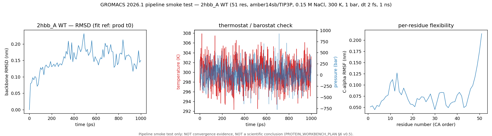

# GROMACS 流程验证（smoke test）报告 — v0.5-01

> **run 类别：`pipeline_smoke_test`（流程验证，非科研模拟）**
> 日期：2026-11-13｜run_id：`20261113_184917_gromacs_smoke_2hbb_A`｜代码基线：git `8f53643`
> 对应规划：`PROTEIN_WORKBENCH_PLAN.md` §6 v0.5 首项
> **本报告的所有结果仅证明"命令链可运行、输出可追溯"，不代表动力学收敛，不构成任何科学结论，不得用于筛选、评分或亲和力判断。**

---

## 1. 结论速览

| 项目 | 结果 |
|---|---|
| 命令链 | pdb2gmx → editconf → solvate → genion → EM → NVT(100 ps) → NPT(100 ps) → 生产 MD(1 ns) → RMSD/RMSF/能量分析，**全部成功** |
| 总墙钟 | **122 s**（18:49:17–18:51:19，含输入校验、绘图与 manifest 写入） |
| GPU 是否生效 | **是，双重证据**（mdrun 日志选择 GPU + 运行期 nvidia-smi 采样），详见 §4 |
| 生产段性能 | 1103.8 ns/day（仅作流程观察数字，不作收敛性论证） |
| 记录完整性 | `manifest.json`：13 步命令列表/退出码/耗时 + 15 个关键产物 sha256 + 全部参数与种子 + GPU 证据原文 |
| 产物位置 | `runs/gromacs_smoke/20261113_184917_gromacs_smoke_2hbb_A/`（`runs/` 不入仓库），分析图入 `docs/gromacs_smoke_test_2hbb_A.png` |

分步耗时：pdb2gmx 0.02 s / editconf 0.01 s / solvate 0.07 s / grompp+genion ≤0.14 s / **EM 8.5 s** / **NVT 14.4 s** / **NPT 16.9 s** / **生产 MD 80.5 s** / 三个分析步合计 ≈0.15 s。

## 2. 输入体系与来源

- **结构**：`runs/20261113_113523_2hbb_A10E/inputs/clean_protein.pdb`——**v0.4 评测实际使用的 2HBB WT 输入**（该 run 是突变任务，`inputs/` 存的是未突变的 WT 清理版）。
- sha256：`fa7a67cd10df7ea9d0111d897d93d22a94dbd47b7c260b63218a6e37394231fb`（run 目录留有副本 `input/2hbb_A_wt_input.pdb`）。
- 体系核实（脚本前置校验，在耗费任何 gmx 时间之前）：**链 A 单链、51 残基（1–51 连续编号）、无 HETATM、无 MODEL 记录、全部标准氨基酸**。
- 选择理由：v0.4 已跑过的结构（计划 §6 要求从熟悉体系开始）；单链小体系使流程验证快且省资源。

## 3. 方法与全部参数（manifest 同步记录）

| 项 | 值 |
|---|---|
| 力场 / 水模型 | AMBER14SB / TIP3P（`pdb2gmx -ignh`，氢原子重建） |
| 端基与质子化 | pdb2gmx 默认逻辑（MET1 / LYS51 端基自动识别，见 `logs/01_pdb2gmx.log`） |
| 盒子 | 十二面体，蛋白-盒边最小距离 1.0 nm（`editconf -c -d 1.0`） |
| 离子 | 0.15 M NaCl，`genion -neutral`；体系 = 813 蛋白原子 + 13,233 水 + 31 离子 = 14,077 原子 |
| EM | steep，emtol=1000 kJ/mol/nm，实际 **279 步收敛**（Fmax=995.8，PE=−2.133×10⁵ kJ/mol） |
| 平衡 | NVT 100 ps → NPT 100 ps；NVT/NPT 加蛋白位置限制（posre.itp，1000 kJ/mol/nm²，参考坐标分别为 em.gro / nvt.gro） |
| 温压控制 | V-rescale（300 K，τ_t=1.0 ps）/ C-rescale（1 bar，τ_p=2.0 ps，compressibility 4.5×10⁻⁵ bar⁻¹） |
| 积分 | dt=2 fs，constraints=h-bonds，PME（1.2 nm），Verlet 截断 1.2 nm |
| 生产段 | 1 ns = 500,000 步，无位置限制；每 10 ps 一帧 → `md.xtc` 101 帧（0–1000 ps） |
| 种子 | NVT 初速度 gen-seed=20261113；生产段 ld-seed=20261113；**NVT/NPT 的 ld-seed 未固定**（grompp 随机指派，实际值已由 grompp 写入 run 目录 `mdout.mdp` 与日志，可追溯）——遗留改进项，见 §9 |
| GPU 运行方式 | `mdrun -gpu_id 0`；单 rank；环境经 `configs/gromacs_env.sh` 注入（GMXRC + cuFFT11 兼容层，方案 A，v0.1-01 已固化） |
| 软件 | GROMACS 2026.1（/opt/software，mixed 精度，GPU support: CUDA，CUDA runtime 12.80 / driver 13.0，sm_120，cuFFT GPU FFT） |

## 4. GPU 是否真的生效：证据原文（计划 §6 明确不以"机器有卡"为准）

**证据一：mdrun 日志（`md.log`，关键行已全文存入 manifest `gpu_evidence_mdrun_log`）**

```
1 GPU selected for this run.
PP tasks will do non-perturbed short-ranged interactions on the GPU
PME tasks will do all aspects on the GPU
```

任务分配统计表显示真实 GPU 工作负载：`Launch PP GPU ops` 占墙钟 20.1%、`PME GPU mesh` 19.9%、`Launch PME GPU ops` 18.7% 等（全文在 manifest）。

**证据二：运行期 nvidia-smi 采样（`gpu/nvidia_samples.csv`，32 个采样点，间隔 5 s）**

生产段 GPU0 显存 **基线 15 MiB → 峰值 387 MiB**（Δ=372 MiB ≈ 小体系 GROMACS CUDA context 量级；判定规则为"峰值 − 该卡基线 > 200 MiB"，不设固定绝对阈值——小体系的显存占用本身就只有几百 MiB，固定阈值会误判，本项目的第一次实现就吃过这个亏，已在脚本注释中说明）。

**自动判定结论（manifest `gpu_used_assessment`）**：`GPU 实际参与（mdrun 日志选择 GPU 且 nvidia-smi 观察到进程驻留）`。

## 5. 流程观察结果（⚠️ 仅观察统计，非科学结论）



| 观察量 | 值 | 说明 |
|---|---|---|
| 温度 | **299.89 ± 2.49 K** | 恒温器按 300 K 目标工作，波动正常 |
| 压强 | 14.57 ± 211.82 bar | 小体系瞬时压强涨落的正常量级 |
| 势能 | −192,725 kJ/mol 量级 | 量级稳定 |
| 骨架 RMSD | 前 10 ps 均值 0.040 nm → 全程均值 0.152 / 最大 0.231 nm | 先弛豫上升后平台化，形态学上合理 |
| C-alpha RMSF | 核心低（~0.05 nm），**C 端尾部最高（0.22 nm）** | 与末端柔性预期一致 |

图：三栏 = 骨架 RMSD（拟合参考=生产段 t0）/ 温度+压强 / 逐残基 C-alpha RMSF；轴单位、时间范围（0–1000 ps）、体系条件与免责声明均已标注。

**以上数字只说明"仪器读数在正常范围"，不说明体系收敛、平衡充分或任何生物学性质。**

## 6. 与科研模拟的边界（本报告必须保留的声明）

- 1 ns ≪ 任何平衡/采样需求；本 run **未评估收敛性**（manifest 固定写入 `convergence: not_assessed`）。
- 产物**不得**用于筛选、评分、亲和力或任何科学结论（manifest 固定写入 `scientific_conclusion: none`）。
- 脚本层面护栏：`--ns > 5.0` 直接拒绝（更长的科研模拟必须走正式工作流，不允许借 smoke 工具绕过）；输出目录时间戳隔离，已存在即拒绝，不覆盖任何旧结果。
- CBM13—糖配体体系**不在本流程内**：配体、修饰、力场与参数化未经确认，按计划阻塞，等参数来源明确后单独处理。

## 7. 调试迭代记录（4 次失败，如实保留现场）

| # | 失败 run | 根因 | 修复 |
|---|---|---|---|
| 1 | `…181337` | ions 准备步 grompp 用 PME，而 solvate 后体系**带净电荷** → GROMACS 按规范 WARNING→fatal（"Ewald electrostatics in a system with net charge"） | ions.mdp 改 `coulombtype = cut-off`（官方教程做法：该 tpr 仅作 genion 选水输入，从不跑动力学；中和后的正式 grompp 不再有此警告） |
| 2 | `…181601` | `define=-DPOSRES` 时 GROMACS ≥2018 要求**显式 `-r` 参考坐标**，NVT grompp 缺失 | NVT 加 `-r em.gro`，NPT 加 `-r nvt.gro` |
| 3 | `…183646` | `gmx rmsf -res` 在 2026.1 是**布尔开关**不是输出文件名；且本次实测该开关退出码 0 却未生成 `res-rmsf.xvg`（行为存疑，如实记录未深究） | 放弃 `-res`，用 C-alpha 逐原子 RMSF（51 个 CA 与残基一一对应） |
| 4 | `…183203` | rmsf 输出 x 列是**全体系原子序号**（CA 分散在 1..793），绘图误当残基号，图上出现"800 个残基" | 按 CA 出现顺序重建残基号 1..51（单链连续编号已由输入校验确认） |

（`…182255` 为第 3 项的前身：`-res` 传文件名直接参数错误。）失败 run 目录全部保留不清理，作诚实记录。

## 8. 环境变更记录

- `rosetta-agent` env **新增 matplotlib 3.10.9**（pip 安装；随装 contourpy/cycler/fonttools/kiwisolver/pyparsing/python-dateutil/packaging；**numpy 2.2.6 等既有包未动**）。用途：smoke test 分析绘图。此前该 env 无任何绘图库、系统 python3 也没有。
- `configs/gromacs_env.sh` 本次未改（v0.1-01 固化的方案 A 直接可用）。

## 9. 遗留与下一步

**遗留（如实）**：
1. NVT/NPT 的 ld-seed 未固定（实际值可从 `mdout.mdp` 追溯）——正式工作流应全阶段固定种子；
2. 正式科研模拟工作流（长时模拟、多副本、收敛判据、资源核算、ckpt 续跑）**未实现**，属 v0.5-02+；
3. 轨迹分析目前是 smoke 工具内置的"能出图"，尚未整理为 workbench 正式子命令；
4. 1DIV 等其他结构未跑（非必需，流程验证单体系足够）。

**建议下一步（v0.5-02）**：把该流程封装为 `workbench/executors/gromacs`（任务级 manifest 接入现有 runs 状态体系），再按用户确定的科研问题设计正式模拟。

**待用户确认的科研问题**：
- 正式模拟要回答的科学问题是什么（CBM13—糖界面?稳定性相关构象变化?）；
- 可接受的模拟时长/副本数/GPU 时长预算；
- CBM13 糖配体的力场与参数来源（GLYCAM06?-acpype? 已有参数文件?）——参数不全时该体系继续阻塞，不凭经验虚构参数。

## 10. 复现命令

```bash
cd ~/projects/rosetta1
# 脚本内部自行 source configs/gromacs_env.sh；人工验证环境可用：
source configs/gromacs_env.sh && gmx --version   # 应显示 2026.1 / GPU support: CUDA

~/.conda/envs/rosetta-agent/bin/python scripts/gromacs_smoke_test.py \
    --input runs/20261113_113523_2hbb_A10E/inputs/clean_protein.pdb \
    --label 2hbb_A --ns 1.0 --gpu-id 0
```

产物核对：`runs/gromacs_smoke/<run_id>/manifest.json`（status=succeeded、13 步退出码全 0、`gpu_used_assessment.conclusion`、15 个产物哈希）。
